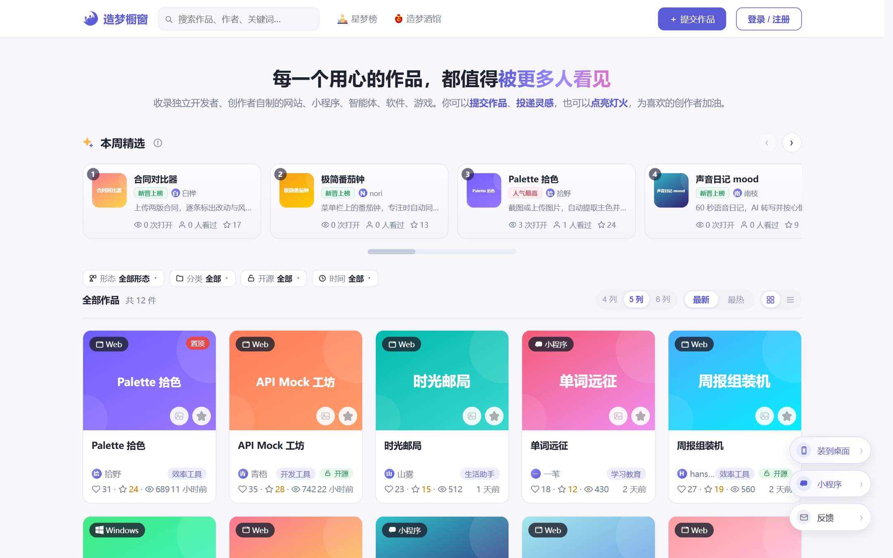
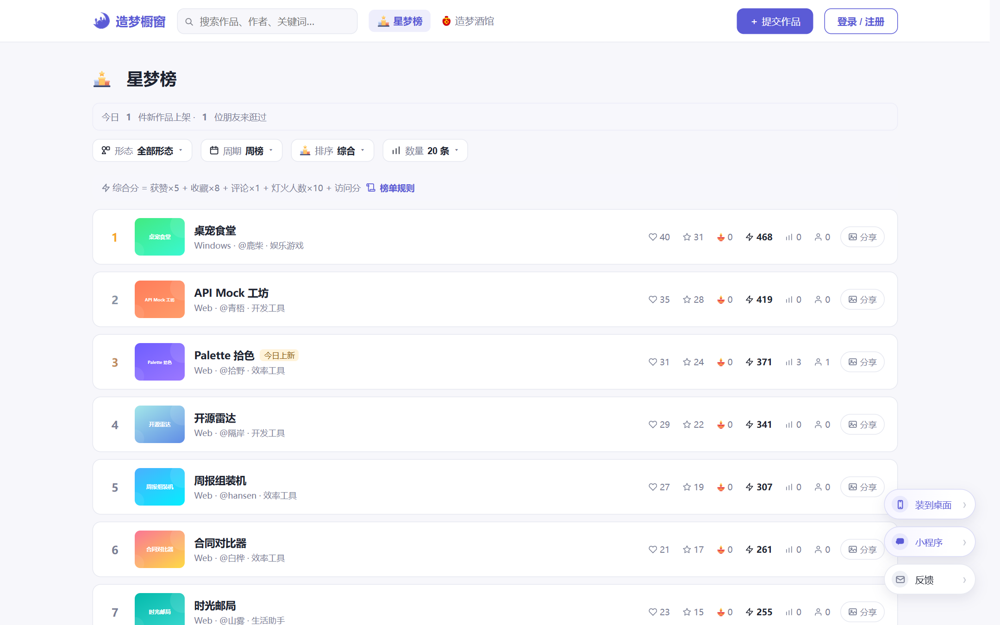
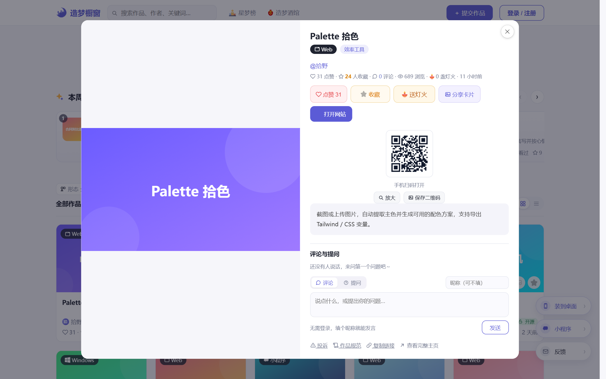

# Dream Case · 造梦橱窗

> Every idea built with care deserves to be seen.

   

**简体中文说明：[README.zh-CN.md](README.zh-CN.md)** · Live demo: <https://idea.v5pc.com> · License: MIT

An open-source showcase and discovery platform for AI-built products: websites, WeChat mini programs, mobile apps, agents, desktop tools and browser extensions. Visitors browse, like, bookmark, comment and tip. Authors earn **Lanterns** (灯火, the in-site points currency) from their work and spend them to give their own submissions more exposure.

**Tech stack:** Node.js 20 + Express 4 (single-file backend) · vanilla JavaScript + CSS frontend, no framework and no build step · JSON file storage with local uploads · PM2 + Nginx.

## Screenshots







The interface is currently Chinese-only; the screenshots above come from the live site.

## More than a portfolio template

Most open-source "showcase" projects stop at CRUD plus a card grid. This one ships the mechanism that keeps a small community moving on its own:

- **Lantern economy** — points can be earned in dozens of ways: daily check-in, referral visits / sign-ups / QR scans, open-sourcing a work, automatic rewards when a linked GitHub repo gains stars, uploading a work, installing the PWA, watching a rewarded video, receiving tips, and more. Every earning path has its own abuse quota, and the full ledger is visible to the user.
- **Promoted slots (author self-promotion)** — authors redeem Lanterns for exposure on the home page, the leaderboard and work pages. Slots are billed on impressions and clicks, exclusive slots have a queue, and buying the top home slot for a freshly published work triggers a confirmation step because that work already occupies the first position.
- **Ad placements** — the site owner sells text / image placements from the admin panel. These are deliberately separate from author-promoted slots and are always labeled **Ad**, never "Promoted", so commercial ads and community self-promotion cannot be confused.
- **Dream Tavern** (`/bar`, 造梦酒馆) — people describe a product they wish existed, creators pick it up and build it, closing the loop from demand to work.
- **Two clients, one backend** — a responsive web app (PC + mobile, installable as a PWA) plus a native WeChat mini program. The mini program is maintained separately and is **not included in this repository**; it talks to the same API.

## Features

**Content & discovery**
- Filter the feed by category / format / open-source status, keyword search, newest or hottest sorting, card and list views
- Featured carousel, pinned works, upcoming (WIP) cards
- Leaderboards: weekly / monthly / all-time, ranked by overall heat, likes or bookmarks
- Trending searches from real queries plus a cold-start seed list that can be switched off in one line
- A site-wide chronicle timeline

**Lanterns**
- 7-day rising daily check-in; three-stage referral attribution (visit → sign-up → QR scan) with a 7-day window
- Rewards for open-source works, GitHub star growth, uploads, PWA installs, QR scans of shared cards
- Tipping between authors, and "light a lantern for this work" where a visitor watches an ad and the platform pays the author (the visitor spends nothing)
- Full points ledger and in-site notifications for sensitive operations

**Anti-abuse**
- In-memory sliding-window rate limiting; per-IP / per-visitor / per-work quotas
- Referral caps per IP and per day, daily sign-up circuit breaker, attribution expiry
- Ad billing caps per visitor per ad per day using a rolling 24-hour window (crossing midnight does not reset it)
- Sensitive-word filtering, reserved account names, impersonation protection, anonymous submissions queued for review
- Optional AI pre-review (Zhipu GLM) and WeChat `msgSecCheck`

**SEO & distribution**
- Server-rendered HTML with JSON-LD for `/w/:id`, `/u/:name`, `/rank` and `/bar`
- Auto-generated `sitemap.xml`, `robots.txt`, RSS `feed.xml` and `llms.txt`
- Auto-composed share cards plus attributed mini-program QR short links at `/go/:code`

**Accounts**
- Username + password, GitHub OAuth, Google OAuth, WeChat mini-program login (each entry appears only when configured)
- Claim a work, bind a WeChat account (one-time reward, protected against multi-account farming), mute works and authors

**Admin panel** (`/admin`)
- Works, users, comments, reports, claims, ads, promoted-slot orders, gift codes
- PV / UV, traffic composition (referring domain, device, landing page), outbound channel stats, search-term analysis
- A dashboard that separates organic traffic from experience events (open / download / scan intent)

## Stack and trade-offs

| Layer | Choice |
| --- | --- |
| Runtime | Node.js 18+ (20 recommended) |
| Web | Express 4, a single `server.js` organized by `// ---------- section ----------` comments |
| Frontend | Plain JavaScript + CSS, **no framework, no build step** |
| Storage | JSON files (atomic writes + in-memory cache), images in local `uploads/` |
| Uploads | multer |
| Deploy | PM2 behind an Nginx reverse proxy |

Why:

- **Zero build** — clone, `npm install`, run. Edit a frontend file and refresh; there is no toolchain beyond `node_modules`.
- **JSON storage** — plenty for a single small site, and a backup is one archive. All data files load into memory at startup; writes go to a temp file followed by an atomic rename. It is **not** designed for multiple instances or horizontal scaling.
- **Single-file backend** — business areas are separated by section comments; search the comment to jump. See [ARCHITECTURE.md](ARCHITECTURE.md) (Chinese) for the map and the data-file reference.

## Quick start

```bash
git clone git@github.com:fxxqq/dream-case.git
cd dream-case
npm install
npm start
```

Open <http://127.0.0.1:3000>; the admin panel is at <http://127.0.0.1:3000/admin>. The default port is `3000`, override it with `PORT=8080 npm start` (on Windows: `set PORT=8080 && npm start`).

On first boot the app creates `data/` and `uploads/`. If it finds legacy works without accounts, it seeds demo author accounts with the password `123456` — change or remove them before exposing the site. **The admin panel is disabled entirely until an admin key is configured**, so there is no empty-password fallback.

## Configuration

The admin key is never hard-coded. It is read in this order:

1. Environment variable `ADMIN_KEY`
2. `data/admin-key.txt` (handy locally; `data/` is gitignored)

OAuth credentials follow the same pattern: environment variables first, then `data/oauth.json`; providers without credentials are hidden from the login UI.

| Variable | Default | Purpose |
| --- | --- | --- |
| `PORT` | `3000` | HTTP port |
| `ADMIN_KEY` | empty | Admin key; empty disables `/admin` |
| `SITE_ORIGIN` | auto-detected | Full origin such as `https://idea.example.com`, used for sitemap, RSS and share links |
| `REVIEW_MODE` | off | Set to `1` to queue every submission for review |
| `DATA_DIR` | `./data` | Runtime JSON data directory |
| `UPLOAD_DIR` | `./uploads` | Uploaded images directory |
| `GITHUB_CLIENT_ID` / `GITHUB_CLIENT_SECRET` | empty | GitHub login |
| `GITHUB_STAR_TOKEN` | empty | Token used to watch star growth for rewards |
| `GOOGLE_CLIENT_ID` / `GOOGLE_CLIENT_SECRET` | empty | Google login |
| `WECHAT_APPID` / `WECHAT_APP_SECRET` | empty | WeChat mini-program login |
| `ZHIPU_API_KEY` / `ZHIPU_MODEL` | empty | Optional AI pre-review |

One caveat: [deploy.example.sh](deploy.example.sh) still exports a legacy variable named `SITE_URL`, which the server no longer reads. Rename it to `SITE_ORIGIN` if you deploy with that template.

## Project layout

```
.
├── server.js            # Backend: REST API, auth, rate limits, Lantern ledger, anti-abuse, SSR
├── seo.js               # Server-rendered fragments: work / author / leaderboard / sitemap
├── frontend/
│   ├── index.html       # SPA shell
│   ├── app.js           # Routing, feed, modals, submissions, session, Lanterns
│   ├── sharecard.js     # Canvas-composed share cards
│   ├── style.css
│   └── admin.html       # Admin panel
├── docs/                # README screenshots
├── deploy.example.sh    # Deploy script template (copy to deploy.sh and fill in)
├── nginx-example.conf   # Nginx reverse-proxy example
├── DEPLOY.md            # Deployment & operations guide (Chinese)
├── ARCHITECTURE.md      # Architecture & data-file reference (Chinese)
├── data/                # Runtime data (gitignored)
└── uploads/             # User-uploaded images (gitignored)
```

## Deployment

```bash
cp deploy.example.sh deploy.sh   # fill in server IP, admin key, domain
bash deploy.sh                   # pack → upload → remote npm install → PM2 restart
bash deploy.sh restart           # restart only
```

`data/` and `uploads/` on the server are never overwritten, so upgrading the code does not touch existing data. See [DEPLOY.md](DEPLOY.md) (Chinese) and [nginx-example.conf](nginx-example.conf).

## Backups

Everything lives in `data/*.json` and `uploads/`:

```bash
tar czf backup-$(date +%F).tar.gz data uploads
```

## Notes for forks

This is a personal project built for one live site, and several business constants (Lantern amounts, promoted-slot prices, abuse quotas) are tuned for it — expect to adjust them. The UI strings and most code comments are in Chinese; start with `frontend/index.html`, `frontend/app.js` and `seo.js` if you want to translate.

Issues and PRs are welcome, and bug reports with reproduction steps and expected behavior get fixed faster. The WeChat mini program and the site's production data are not part of this repository.

## License

[MIT](LICENSE) © 2026 frank — no extra conditions, just keep the copyright notice.
