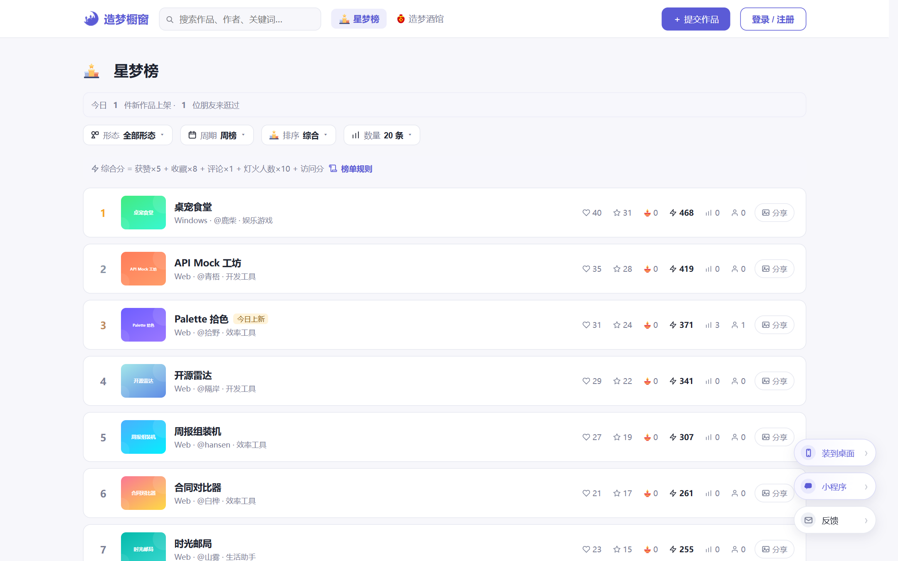
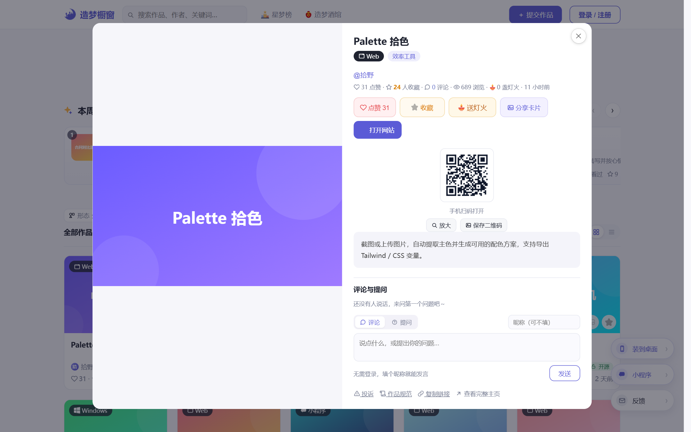

# 造梦橱窗

> 每一个认真做出的想法，都值得被看见。

English version: [README.md](README.md)

   

一个面向 AI 作品的展示与发现平台：网站、小程序、App、智能体、桌面应用、浏览器扩展，都可以提交。访客浏览、点赞、收藏、评论、打赏；作者靠作品挣「灯火」，再用灯火给自己的作品换个推荐位。

**技术栈：** Node.js 20 + Express 4（单文件后端）· 原生 JavaScript + CSS 前端，无框架、无构建 · JSON 文件存储 + 本地图片目录 · PM2 + Nginx 部署。

**线上示例：<https://idea.v5pc.com>**






## 这不是又一个作品集模板

市面上「作品展示站」的开源实现很多，大多是增删改查加个卡片流。这个项目的差异在于：**它内置了一整套让社区自己转起来的机制**，而不只是展示。

- **灯火经济系统**：站内积分「灯火」有 20 种来源 —— 签到、分享链接带来访问、邀请注册、有人扫码、开源作品奖励、GitHub star 涨值自动奖励、PWA 安装、看激励视频、收到打赏……每一种都有独立的风控配额，防止刷分。
- **自助推荐位**：作者用灯火兑换首页第一格、榜单页顶部、作品详情页等曝光位，展示 / 点击双计费，独占位带排队，刚发布的作品换黄金位还有二次确认拦截。
- **广告位**：站长在固定广告位投放文字 / 图片广告，与作者自荐的推荐位相互独立、标识分明。
- **造梦酒馆**：用户说出想要的作品，社区创作者认领实现 —— 补齐「需求 → 作品」的闭环。
- **双端**：Web（PC + H5 响应式，PWA 可装到桌面）+ 微信小程序，两端共用一套后端。

## 功能总览

**内容与发现**
- 首页作品流：分类 / 形态 / 是否开源三级筛选、关键词搜索、最新 / 最热排序、卡片与列表两种视图
- 精选轮播、置顶作品、即将上线预告卡（WIP）
- 榜单：周榜 / 月榜 / 总榜，综合热度、点赞、收藏多维排序
- 热搜榜：真实搜索词 + 可一键关闭的冷启动种子词
- 造梦编年史：全站大事记时间线

**灯火（积分）体系**
- 每日签到（7 天循环递增）、分享归因奖励（点击 → 注册 → 扫码三级归因，7 天归因窗口）
- 开源作品奖励、GitHub star 涨值自动发奖、上传作品奖励、PWA 安装奖励
- 作者间打赏、观众「看广告替作品点灯」（平台代送，观众不花自己的灯火）
- 灯火流水全部可查，敏感操作有站内通知

**风控与反刷**
- 内存滑动窗口限流；单 IP / 单访客 / 单作品多维配额
- 分享归因：同 IP 对同一分享者每日访问与注册上限、单日邀请注册熔断、归因有效期
- 广告计费防刷：同访客同广告每日曝光 / 点击分别限额，滚动 24 小时窗口，跨零点刷无效
- 敏感词过滤、账号名保留词与冒充防护、匿名投稿进审核队列
- AI 初审（智谱 glm-4-flash）+ 微信内容安全 msgSecCheck 可选接入

**SEO 与分发**
- 作品页 `/w/:id`、作者主页 `/u/:name`、榜单页 `/rank`、酒馆 `/bar` 均由服务端直出 HTML，带 JSON-LD 结构化数据
- 自动生成 `sitemap.xml`、`robots.txt`、RSS `feed.xml`、`llms.txt`
- 分享卡片自动合成图 + 带归因参数的小程序码短链 `/go/:code`

**账号**
- 用户名密码 + GitHub OAuth + Google OAuth + 微信小程序登录（配置了才显示对应入口）
- 认领作品、绑定微信（有一次性奖励，防多号刷取）、屏蔽作品与作者

**后台 `/admin`**
- 作品 / 用户 / 评论 / 投诉 / 认领 / 广告 / 推荐位订单 / 兑换码管理
- PV / UV / 流量构成（来源域名、设备、落地页）、外宣渠道统计、搜索词分析
- 数据看板区分自然流量与体验动作埋点（访问 / 下载 / 扫码意图）

## 技术栈与取舍

| 层 | 选型 |
| --- | --- |
| 运行时 | Node.js 18+（推荐 20） |
| Web | Express 4，单文件 `server.js`（约 1.2 万行，按功能分区注释导航） |
| 前端 | 原生 JavaScript + CSS，**无框架、无构建步骤** |
| 小程序 | 微信原生开发，在独立目录维护 |
| 存储 | JSON 文件（原子写入 + 内存缓存），图片存本地 `uploads/` |

为什么这么选：

- **零构建**：clone 下来 `npm install` 直接跑，改前端刷新即生效，没有 node_modules 之外的任何工具链。
- **JSON 存储**：单机小站每天几十万次写入完全够用，备份就是打包一个目录。所有数据文件在启动时载入内存，写入走临时文件 + rename 原子落盘。
- **单文件后端**：所有业务按 `// ---------- 分区名 ----------` 注释切段，编辑器里搜注释就能跳转。详见 [ARCHITECTURE.md](ARCHITECTURE.md)。

## 快速开始

```bash
npm install
PORT=3000 node server.js
```

打开 <http://127.0.0.1:3000>，管理后台在 <http://127.0.0.1:3000/admin>。

首次启动会自动创建 `data/` 与 `uploads/` 目录，并在没有用户数据时建立演示账号。

## 配置

后台口令**不写在代码里**，按以下优先级读取：

1. 环境变量 `ADMIN_KEY`
2. 文件 `data/admin-key.txt`（推荐本地使用，`data/` 已被 `.gitignore` 排除）

未配置时后台整体禁用，避免空口令放行。OAuth 密钥同理：优先环境变量，其次 `data/oauth.json`，都没配置时对应登录入口自动隐藏。

| 环境变量 | 默认值 | 说明 |
| --- | --- | --- |
| `PORT` | `3000` | 服务端口 |
| `ADMIN_KEY` | 空 | 后台管理口令，为空则后台不可用 |
| `SITE_URL` | 自动识别 | 站点完整域名，用于 sitemap 与分享链接 |
| `REVIEW_MODE` | 关闭 | 设为 `1` 时所有投稿都需审核 |
| `GITHUB_CLIENT_ID` / `GITHUB_CLIENT_SECRET` | 空 | GitHub 登录 |
| `GOOGLE_CLIENT_ID` / `GOOGLE_CLIENT_SECRET` | 空 | Google 登录 |
| `WECHAT_APPID` / `WECHAT_APP_SECRET` | 空 | 小程序登录 |

## 目录结构

```
.
├── server.js            # 后端：REST API、鉴权、限流、灯火账本、风控、SEO 直出
├── seo.js               # 服务端渲染片段：作品页 / 作者页 / 榜单页 / sitemap
├── frontend/
│   ├── index.html       # 站点主页面（SPA 壳）
│   ├── app.js           # 前端逻辑：路由、列表、弹窗、投稿、登录态、灯火
│   ├── sharecard.js     # 分享卡片图合成（Canvas）
│   ├── style.css
│   └── admin.html       # 管理后台
├── docs/                # README 截图
├── deploy.example.sh    # 部署脚本模板（复制为 deploy.sh 后填配置）
├── nginx-example.conf   # Nginx 反向代理示例
├── DEPLOY.md            # 部署与运维说明
├── ARCHITECTURE.md      # 架构与数据文件说明
├── data/                # 运行时数据（不入库）
└── uploads/             # 用户上传的图片（不入库）
```

## 部署

```bash
cp deploy.example.sh deploy.sh   # 填入服务器 IP、后台口令、域名
bash deploy.sh                   # 打包 → 上传 → 远程安装依赖并重启 PM2
bash deploy.sh restart           # 只重启服务
```

服务器上 `data/` 与 `uploads/` 不会被覆盖，升级代码不影响已有数据。详细步骤见 [DEPLOY.md](DEPLOY.md)。

## 数据备份

所有业务数据都在 `data/*.json` 与 `uploads/` 两个目录里，定期打包即可：

```bash
tar czf backup-$(date +%F).tar.gz data uploads
```

## 关于维护

这是个个人项目，为 idea.v5pc.com 服务，不少业务参数（灯火数值、推荐位定价）是按自己站的情况调的，Fork 后大概率要改。

- 项目在持续维护：bug 会修，体验会调，issue 和 PR 都会看。
- 提问题时写清复现步骤和预期结果，能省掉不少来回。
- 想怎么改就怎么 Fork，MIT 没有附加条款，只需保留版权声明。

## License

[MIT](LICENSE)
